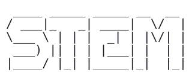
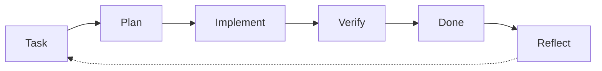

**Spec Driven Agentic Coding Starter Kit**

`[ you ]──▶[ STEM ]──▶[ more you ]`

**Version 1.1.2** ·  

🇬🇧 **English version: [README.md](README.md)**

[Nutzung](#nutzung) · [Ablauf](#ablauf) · [Updates](#aktuell-bleiben) · [Prompt](#start-prompt) · [Inhalt](#inhalt) · [Prinzipien](#prinzipien)

LLM-Harnesses ändern sich ständig. Wäre es nicht großartig, ein neues Projekt gleich mit allen **aktuellen** Best Practices zu starten? Das ist [STEM](https://www.imdb.com/title/tt6499752/) – ein Starter-Template für agentisches Coding.

Minimale, mitwachsende Basis für agentische Entwicklung (Claude Code, Codex, GitHub Copilot) mit Git und [Backlog.md](https://github.com/MrLesk/Backlog.md) – token-sparsam und nachvollziehbar.

*Der Name ist eine Anspielung auf das KI-Implantat im Film [Upgrade](https://www.imdb.com/title/tt6499752/) (2018): ein System, das mit dir arbeitet und erweitert, was du kannst, während du die Kontrolle behältst.*

## Nutzung

**Standardweg (kein technisches Wissen nötig):**

1. [ZIP herunterladen](https://github.com/Akku/stem/archive/refs/heads/main.zip) und entpacken.
2. Den Ordner im Agenten öffnen.
3. Den Prompt aus [STARTE_HIER.md](STARTE_HIER.md) geben.

Der Agent installiert dann fehlende Werkzeuge gemeinsam mit dir, richtet Git und Backlog.md ein, hilft dir, die Idee in Vertical Slice, MVP und Moonshot zu schärfen, passt das Harness an dein Ziel an und legt Backlog.md-Meilensteine und erste Tasks an.

**Technisch Versierte:** auf GitHub **Use this template** wählen oder das Repository klonen, dann derselbe Prompt.

Pro Sitzung führt der Agent `scripts/session-start.sh` aus (kurzer Zustandsüberblick).

## Ablauf

Spec-Driven Development on Steroids: Die Idee wird zuerst zu einer Spezifikation geschärft, danach läuft jede Änderung durch dieselbe nachvollziehbare Schleife, und das Harness lernt aus jeder Runde.

Reflect ist der Skill `retro`: Learnings fließen ins Harness zurück (und, wenn bewährt, ins Kit).

## Aktuell bleiben

Zu Beginn jeder Sitzung prüft der Agent (einmal pro Tag), ob es eine neuere Kit-Version gibt, und sagt dir Bescheid. Mit deiner Zustimmung liest der Skill `stem-update` das [Changelog](CHANGELOG.md), wählt aus, was deinem Projekt nützt, und übernimmt es, ohne projektspezifische Inhalte zu überschreiben. Auch der Skill `retro` prüft das Kit.

## Start-Prompt

Gib dies dem Agenten, nachdem du den Ordner geöffnet hast:

> Richte dieses Projekt ein: Folge `SETUP.md`. Arbeite in meiner Sprache und installiere alles, was fehlt, selbst (ich genehmige die Schritte). Was ich entwickeln will, ist folgendes: *<deine Idee: was, für wen, woran erkennt man „fertig“ – ein paar Sätze>*

## Inhalt

Alle Dateien anzeigen

| Datei | Zweck |
| --- | --- |
| `STARTE_HIER.md` / `START_HERE.md` | Anleitung für Menschen (DE/EN) |
| `.claude/skills/` | Skills: `retro`, `alignment`, `handoff`, `promote-learning`, `testing-practices`, `stem-update` |
| `.claude/agents/` | Agenten: `ux-designer` (für Projekte mit Oberfläche) |
| `SETUP.md` | Einmalige Setup-Anleitung für den Agenten (wird nach dem Setup gelöscht) |
| `AGENTS.md` | Gemeinsame Kernregeln (Codex & kompatible Tools) |
| `CLAUDE.md` / `.github/copilot-instructions.md` | Dünne Adapter, verweisen auf `AGENTS.md` |
| `scripts/githooks/pre-commit` | Schutz vor dem Committen vertraulicher Quelldokumente (wird beim Setup aktiviert) |
| `KIT_VERSION`, `CHANGELOG.md` | Kit-Version, auf der das Projekt basiert; Änderungen je Version |
| `.claude/settings.json` | Claude Code: sichere Befehle vorab freigegeben, Sitzungsstart-Hook |
| `LICENSE` | MIT (Kit); `.github/kit-check.py` + Workflow prüfen das Kit selbst |
| `scripts/check-backlog.sh`, `scripts/retro-metrics.sh` | Backlog-Konsistenzprüfung (auch im Pre-commit-Hook); Messwerte für Retros |
| `docs/agent/stacks/` | Stack-spezifische Hinweise, nur bei passendem Stack geladen |
| `scripts/context-report.py` | Optionales Retro-Werkzeug (Claude Code): wohin der Kontext floss, längste Sitzungen; nur Zahlen |
| `scripts/context-check.py` | Claude-Code-Hook: warnt bei großem Kontext, dass eine neue Sitzung fällig ist |
| `scripts/run.sh` | Kompakte Ausgabe für Tests/CI/CLI (Exitcode bleibt erhalten, Volllog außerhalb des Repos) |
| `scripts/session-start.sh` | Lesender Sitzungsstart (Branch, Änderungen, Tasks, Übergabe) |
| `docs/agent/OPERATING_MODEL.md` | Regeln mit stabilen IDs (`R-*`), gezielt per ID geladen |
| `docs/agent/ADVANCED.md` | Selten gebrauchte Regeln (Parallelität, Messung, Routing, lokale Modelle) |
| `docs/agent/EXPERIMENTS.md` | Hypothesen, Messgrößen, Basislinien und Evidenzgrade für dauerhaft kostenwirksame Regeln |
| `docs/agent/LEARNINGS.md` | Beobachtungen für die Retro (enthält Startpunkte für die erste Retro) |
| `docs/agent/PITFALLS.md` | Wachsende Liste technischer Stolperfallen |
| `docs/agent/PROCESS_IMPROVEMENTS.md` | Retro-Behandlung und Rückfluss ins Kit |

## Prinzipien

- Informationsarchitektur statt „kürzer antworten": kurze Einstiege, Vertiefung nach Bedarf, Volllogs außerhalb des Kontexts.
- Eine verbindliche Quelle je Regel; Adapter verweisen nur.
- Das Harness wächst durch Retros, nicht durch Vorrat (`R-DECISION`).

## Beitragen

Bewährte Learnings aus Projekten bitte per Pull Request einbringen (Muster: Problem, Muster, Geltungsbereich, Evidenz – siehe `docs/agent/PROCESS_IMPROVEMENTS.md`). Keine Projekt- oder Firmeninterna, keine Zugangsdaten – das Repository ist öffentlich. Ablauf und Checkliste (englisch): [CONTRIBUTING.md](CONTRIBUTING.md).
